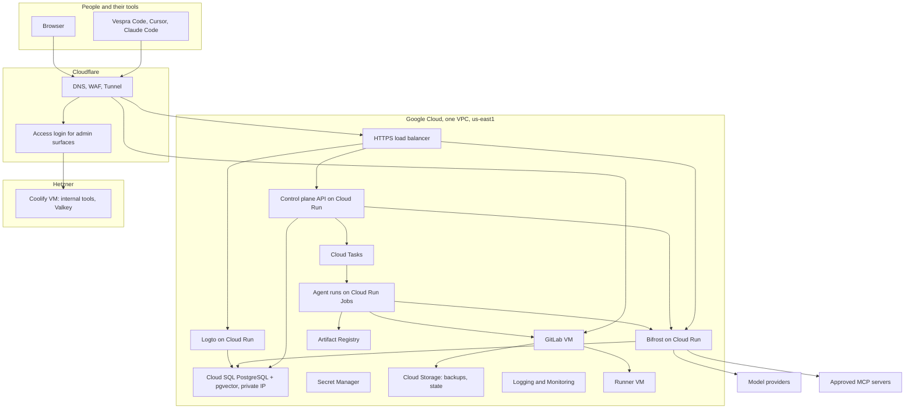
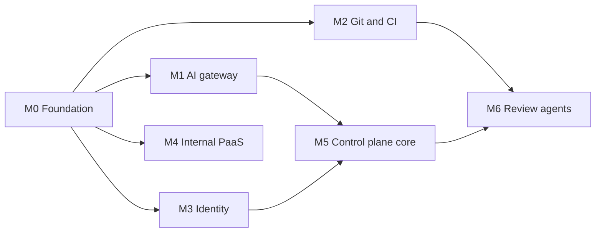

# Vespra Platform: Phase 1 spec

Status: ready-for-agent. Decisions are final unless a row is marked **New**, which means it was decided in this document to close a gap and should be reviewed first.
Date: 2026-11-12. Owner: Austin (`austin@vespra.cloud`).
Supersedes the component picks in the [Vespra Gateway plan of 25 Oct 2026](discussions/2026-10-25-vespra-gateway-plan.md). The product shape in that plan still stands and becomes Phase 2.

How this document is laid out: the executive summary and the final decisions come first, then the spec proper (problem, solution, user stories, implementation, testing, out of scope, notes), then the milestones and the list of what is still needed from a person.

---

## Executive summary

**What Vespra is.** Vespra is a private developer platform where software is built by people and AI agents working in the same place. It has five parts that share one login, one organization model and one bill:

1. **Vespra Code**: the editor (a fork of Code OSS with an Agents window and an Agent Host that runs Claude, Codex and other agents). It exists today.
2. **Git**: source hosting, merge requests and CI.
3. **AI gateway**: one endpoint for every model and every agent tool (MCP), with per-key budgets and logs.
4. **Agents**: a platform that runs agents on demand in disposable sandboxes, first for code review and security review, later for anything a team or a customer defines.
5. **Cloud**: a place to deploy apps, databases and models. Internal only at first; a customer-facing version comes later.

A **control plane** sits over all five. It knows organizations, members, keys, budgets, policy and audit. The internal admin dashboard and the future customer dashboard are two front ends on that one API.

**Who it is for, in order.** Austin now. A small Vespra team next. Outside organizations after senior engineers have reviewed the platform. There are no customers yet, so Phase 1 optimizes for a solo founder with a tight budget, while keeping every data structure multi-tenant so that adding customers is not a rewrite.

**What Phase 1 delivers.** A working internal platform that Austin uses every day to build the rest of Vespra:

- one AI gateway URL and key for every editor and agent, with hard spend limits
- a private Git server with CI and proven backups
- single sign-on for people and machine identities for agents
- an internal PaaS for internal tools
- a control plane core with organizations, keys, budgets and audit
- two agents that review every merge request, one for code quality and one for security

**How it is built.** Google Cloud is the home cloud. Cloudflare is the edge. Everything is defined in OpenTofu. Open-source components are self-hosted where that protects privacy (GitLab, Bifrost, Logto, Coolify); managed Google services are used where running it yourself adds work without adding control (database, secrets, queues, logs).

**Rough running cost.** About 130 to 280 US dollars a month before model usage. This is an estimate built from list prices in the research notes, not a quote; the Google Cloud architecture session produces the priced bill of materials. Model usage is extra and is capped by gateway budgets.

**The four largest risks.**

1. Too many moving parts for one person. Mitigation: milestones are ordered so each one is useful alone, and three components are deliberately deferred (APISIX, Cloudflare AI Gateway and a dedicated secrets manager).
2. A self-hosted Git server that loses data. Mitigation: a restore drill is an exit test, and platform code stays on GitHub until the drill passes.
3. Tenant isolation done by convention instead of by enforcement. Mitigation: database row-level security plus an automated test that tries to read across organizations.
4. Runaway AI spend. Mitigation: every model call goes through a virtual key with a hard budget.

---

## Final decisions

**Locked** means agreed during planning and research. **New** means decided here to close a gap.

### By layer

| Layer | Decision | Runs on | Status | Revisit when |
|---|---|---|---|---|
| Edge | Cloudflare for DNS, WAF, DDoS protection and Tunnel | Cloudflare | Locked | Not planned |
| Edge | Cloudflare Access on its free tier (reported as up to 50 seats) in front of every admin surface: Coolify, Logto admin console, Bifrost management UI, internal admin dashboard | Cloudflare | New | The team outgrows the free tier |
| Edge | Cloudflare AI Gateway is not used | n/a | Locked | Bifrost caching or analytics prove insufficient |
| Edge to Cloud Run | One external HTTPS load balancer in front of the Cloud Run services; services accept traffic only from that load balancer; the load balancer accepts traffic only from Cloudflare | Google Cloud | New | The Google Cloud architecture session finds a cheaper pattern with the same lock |
| Home cloud | Google Cloud, single region `us-east1` | Google Cloud | Locked (cloud), New (region) | A customer needs another region |
| Network | One VPC. No public IP on any VM. Inbound to VMs only through Cloudflare Tunnel. Admin SSH through Identity-Aware Proxy. Cloud SQL on private IP only | Google Cloud | New | Not planned |
| Git | GitLab Free (Enterprise Edition package, no licence) installed with Omnibus on its own VM, with its bundled PostgreSQL and Redis | Compute Engine VM, 2 vCPU and 8 GB to start | Locked | Team joins: move to 4 vCPU and 16 GB |
| Git | Git over HTTPS only; SSH port closed. Sign-up disabled, two-factor required. Built-in container registry off | GitLab VM | New | A workflow needs SSH or pushes over 100 MB |
| CI | GitLab Runner with the Docker executor on a separate VM in the same VPC | Compute Engine VM | Locked | Queue times grow: add a second runner |
| AI and MCP gateway | Bifrost, open-source build. Virtual keys, USD budgets, provider fallback, MCP tool allow-lists and Virtual MCP bundles | See next row | Locked | A needed feature exists only in Bifrost Enterprise |
| AI and MCP gateway hosting | Cloud Run, exactly one instance, configuration and logs stored in PostgreSQL | Cloud Run + Cloud SQL | New | Validation in milestone M1 fails: fall back to one small VM |
| API gateway | Apache APISIX is deferred | n/a | Locked | More than one public non-AI API needs shared edge policy |
| Identity | Logto, open-source build, self-hosted. Logto organizations are Vespra organizations. Machine-to-machine applications for services and agents | See next row | Locked | Need for SAML to many customers or multi-admin console: Logto Pro or Keycloak |
| Identity hosting | Cloud Run (sign-in service and admin console as two services from one image) with its own database on the shared Cloud SQL instance | Cloud Run + Cloud SQL | New | Validation in milestone M3 fails: fall back to one small VM |
| Secrets | Google Secret Manager for platform and tenant secrets. Nothing secret in repositories or images. 90-day rotation for provider keys and tokens | Google Cloud | Locked | Need dynamic database credentials or mass revocation: add OpenBao |
| Database | Cloud SQL for PostgreSQL with `pgvector`. One instance, separate databases for the control plane, Logto and Bifrost. Point-in-time recovery on | Google Cloud | Locked (engine), New (one instance, three databases) | A noisy neighbour or a compliance boundary forces a split |
| Tenancy | Every tenant-owned row carries `org_id`; PostgreSQL row-level security enforces it. The internal team is the organization `vespra` | Control plane database | Locked (`org_id`), New (row-level security) | A customer needs a dedicated database |
| Cache | Valkey runs on the Coolify server for apps hosted there. Services on Google Cloud do not depend on it in Phase 1; they use PostgreSQL and Cloud Tasks | Coolify server | Locked (Valkey), New (scope) | A Google Cloud service needs a shared cache: Memorystore for Valkey |
| Compute | Cloud Run services for the control plane API and gateways; Cloud Run Jobs for agent runs | Google Cloud | Locked | A workload needs Docker-in-Docker or a GPU |
| Async work | Cloud Tasks for agent jobs, webhooks, retries and schedules | Google Cloud | Locked | Many subscribers per event: add Pub/Sub |
| Internal PaaS | Coolify, self-hosted, for internal tools and previews only. Nothing a customer depends on and nothing that needs the private database runs here | One Hetzner VM | Locked (Coolify, Hetzner), New (the boundary rule) | Not planned |
| Customer compute | Not built in Phase 1. When built, it is Vespra's own control plane driving Cloud Run and OpenTofu, not Coolify | n/a | Locked | Phase 3 |
| Observability | Google Cloud Logging and Monitoring with uptime checks on every public hostname. Alerts for gateway errors, GitLab down, backup failure and spend. Own services emit structured logs and OpenTelemetry traces | Google Cloud | Locked (stack), New (alert list) | Many services and noisy logs: add Grafana |
| Cost control | Google Cloud billing budget with alerts, plus Bifrost budgets per virtual key | Google Cloud, Bifrost | New | Not planned |
| Email | Resend free tier through Logto's SMTP connector | Resend | Locked | Daily cap is hit: Resend Pro or Amazon SES |
| Images and files | Google Artifact Registry for container images; Cloud Storage for backups and OpenTofu state | Google Cloud | Locked | Not planned |
| Infrastructure as code | OpenTofu with remote state in Cloud Storage. Cloudflare and Hetzner are managed from the same code | Repository | Locked (OpenTofu), New (one codebase for all three providers) | Not planned |
| Multi-cloud | Google Cloud only in Phase 1. The path to other clouds is Vespra's own control plane calling OpenTofu modules per cloud. No Crossplane, no third-party multi-cloud console | n/a | Locked (Google Cloud only), New (the path) | A customer or a credit balance justifies AWS or Azure |
| Agent engine | One engine for internal and customer agents, separated by `org_id` and by tool bundle. First agents: merge request code review and security review | Control plane + Cloud Run Jobs | Locked | Not planned |
| Agent harness | The program that drives the model inside a run is swappable behind a run contract. Default: OpenCode in headless mode (MIT licence, any model through an OpenAI-compatible endpoint) | Agent image | New | M6 shows review quality is poor: try another harness without changing the engine |
| Model providers | Day one: Anthropic and Google Vertex AI through Bifrost. OpenAI, Amazon Bedrock and hosted open-weight models are added as configuration when a workload needs them | Bifrost | New | Not planned |
| Own models and GPUs | Deferred. Hosted open-weight models through an API come first; self-hosted inference (Baseten, RunPod, GPU VMs) is registered in Bifrost as a custom provider when usage justifies it | n/a | Locked | Sustained usage makes hosting cheaper than per-token pricing |
| Dashboards | One control plane API, two front ends: internal admin at `admin.vespra.cloud`, customer app at `app.vespra.io`. Only the API and a minimal admin view are built in Phase 1 | Cloud Run | New | Phase 2 |
| Where platform code lives | New platform repositories start on GitHub in the existing organization and move to the self-hosted GitLab after its restore drill passes. `vespracode` stays on GitHub because it tracks upstream Code OSS | GitHub, then GitLab | New | Not planned |
| Existing LiteLLM | The LiteLLM proxy recorded as already running on Google Cloud keeps running until Bifrost passes its exit test, then is shut down and its database removed | Google Cloud | New | Not planned |
| Compliance | No Vanta or SOC 2 work now. Phase 1 keeps the habits an audit needs later: infrastructure as code, audit log, least privilege, two-factor, backups with restore proof | n/a | Locked | First enterprise customer conversation |
| Domains | `vespra.io` for brand and product; `vespra.cloud` for infrastructure | Cloudflare | Locked | Not planned |

### Considered and rejected

| Rejected | Reason |
|---|---|
| Kong Konnect | The 25 dollar plan adds 100 dollars a month per model and charges for requests, MCP traffic included. Self-hosting its control plane needs an enterprise contract |
| Gravitee Enterprise | MCP and agent features are paid only, from about 2,500 dollars a month |
| LiteLLM | Replaced by Bifrost for the combined model and MCP gateway with budgets in one binary |
| Clerk, Auth0, Okta | Managed only; user data leaves the Vespra network |
| Keycloak | Heavier to run than Logto for one person. Remains the fallback |
| Phase, Infisical, OpenBao, Vault | Another control plane to run. Secret Manager covers Phase 1 |
| Dokploy, CapRover, Zeabur, Tsuru | Coolify covers the internal need with all features free when self-hosted |
| Gitea, Forgejo | Lighter, but weaker merge request, CI and security surface than GitLab for agent workflows |
| Supabase self-hosted, MongoDB, a separate vector database | PostgreSQL with `pgvector` covers relational, document-like and vector needs in one place |
| Terraform | Licence risk for a company that may offer infrastructure as a product; OpenTofu is a drop-in |
| Datadog, Grafana Cloud, Honeycomb | Paid and unnecessary until there are many services |

### Hostnames

| Hostname | Serves | Reachable by |
|---|---|---|
| `vespra.io` | Marketing site | Public |
| `app.vespra.io` | Customer dashboard (Phase 2) | Signed-in users |
| `docs.vespra.cloud` | Documentation (already referenced by Vespra Code) | Public |
| `gateway.vespra.cloud` | Bifrost: models at `/v1`, tools at `/mcp` | Holders of a virtual key |
| `api.vespra.cloud` | Control plane API | Signed-in users and services |
| `auth.vespra.cloud` | Logto sign-in | Public |
| `git.vespra.cloud` | GitLab | Vespra members |
| `admin.vespra.cloud` | Internal admin dashboard | Cloudflare Access |
| `auth-admin.vespra.cloud` | Logto admin console | Cloudflare Access |
| `paas.vespra.cloud` | Coolify | Cloudflare Access |

Bifrost's management UI and management API share the gateway hostname. Only the model and tool paths are public; everything else on that hostname sits behind Cloudflare Access.

### Topology

### Terms used

| Term | Meaning here |
|---|---|
| Organization (org) | The unit that owns data, members, keys and a budget. A customer is an org. The Vespra team is the org `vespra` |
| Control plane | Vespra's own API that records orgs, members, keys, policy, budgets, agents and audit, and tells the other components what to do |
| Virtual key | A key issued by Bifrost that stands in for real provider keys. It carries a budget, a list of allowed models and a list of allowed tools |
| MCP | Model Context Protocol, the standard way an agent calls a tool |
| Tool bundle | A named set of approved MCP tools exposed as one endpoint (Bifrost calls this a Virtual MCP) |
| Agent | A definition: instructions, model, tool bundle and trigger |
| Agent run | One execution of an agent in its own sandbox |
| Harness | The program inside a run that loops between the model and the tools |
| Sandbox | The disposable container a run executes in |
| Row-level security | A PostgreSQL feature that makes the database itself refuse rows belonging to another org |

---

## Problem Statement

Austin is building Vespra alone and wants to build it on Vespra. Today the pieces are scattered. The editor exists, but models are reached through separate keys in each tool, with no single budget or log. Code lives on a third-party host. There is no shared login, no place to run agents unattended, no internal place to deploy tools, and the cloud accounts were set up by hand over time, so nobody can say exactly what is running or rebuild it.

That causes four concrete problems:

- **No control over AI spend or tool access.** Each editor and agent holds its own provider keys. Nothing caps spend, nothing records which agent called which tool, and adding a model means reconfiguring every client.
- **No private home for code and automation.** There is no Git server under Vespra's control, so there is nowhere to attach agents that review merge requests, and no CI that Vespra owns.
- **No shared identity or tenancy.** Without one login and one organization model, every component would invent its own users, and adding customers later would mean rebuilding each one.
- **No reproducible foundation.** Infrastructure that exists only as console clicks cannot be reviewed by the senior engineers Austin plans to bring in, cannot be audited, and cannot be recreated after a mistake.

Austin is capable but is not a full-time engineer. He needs a setup that is safe by default, cheap while there are no customers, simple enough for one person to operate, and built from parts that will not have to be thrown away when a team and customers arrive.

## Solution

A small, complete internal platform, built in an order where each step is useful on its own:

1. **A foundation in code.** The Google Cloud folders, projects, network, secrets store and budgets, the Cloudflare zones, and the Hetzner server are all declared in OpenTofu. A change is a reviewed diff, not a console click.
2. **One AI gateway.** Every editor and agent points at `gateway.vespra.cloud` with one key. The key decides which models and tools are allowed and how much can be spent. Provider keys never leave the gateway.
3. **A private Git server with CI.** GitLab at `git.vespra.cloud`, a separate runner, nightly backups to Cloud Storage and a restore that has actually been performed.
4. **One login.** People sign in through Logto at `auth.vespra.cloud`. Services and agents get machine identities from the same place. Every token names the organization it acts for.
5. **An internal PaaS.** Coolify on its own server for internal tools and previews, behind a login wall.
6. **A control plane core.** An API that creates organizations, members, keys and budgets, maps each key to a gateway virtual key, enforces tenant isolation in the database, and records an audit trail.
7. **Two working agents.** When a merge request opens in GitLab, a code review agent and a security review agent each run in a disposable sandbox, reach models and tools only through the gateway, and post their findings on the merge request.

When Phase 1 is finished, Austin opens a merge request and within minutes sees review comments from both agents, sees what each run cost, and knows that the spend could not have exceeded the budget, that the code never left Vespra's servers, and that the whole platform can be rebuilt from a repository.

## User Stories

Founder and platform owner

1. As the founder, I want one gateway URL and one key for every AI model, so that my editor and every agent share the same models, budget and logs.
2. As the founder, I want Vespra Code, Cursor and Claude Code to work through the gateway with only a base URL and a key configured, so that switching tools does not mean reconfiguring providers.
3. As the founder, I want a hard monthly dollar limit on every key, so that a bug or a runaway agent cannot produce a surprise bill.
4. As the founder, I want to disable any key instantly, so that I can stop a leak or a misbehaving agent in one action.
5. As the founder, I want to see spend by key, model and day, so that I know where the money goes.
6. As the founder, I want to add a model provider in one place, so that clients pick it up without changes.
7. As the founder, I want requests to fall back to a second provider when the first is down, so that agents keep working.
8. As the founder, I want provider keys stored only in the secrets store and injected into the gateway, so that no laptop, repository or agent sandbox ever holds them.
9. As the founder, I want a private Git server that Vespra controls, so that source code is not stored on someone else's platform.
10. As the founder, I want CI pipelines to run on a machine separate from the Git server, so that a build cannot slow down or compromise source hosting.
11. As the founder, I want nightly backups of GitLab stored off the server, so that a disk failure or a bad upgrade does not lose code.
12. As the founder, I want a restore that has been performed at least once, so that I know the backups work before I depend on them.
13. As the founder, I want two-factor sign-in required on GitLab and every admin surface, so that a stolen password is not enough.
14. As the founder, I want an internal PaaS where I can deploy an internal tool from a repository, so that I do not hand-configure a server for each one.
15. As the founder, I want every piece of infrastructure declared in code, so that I can rebuild it, review changes and hand it to a senior engineer.
16. As the founder, I want to see the planned infrastructure change before it is applied, so that I never apply something I did not intend.
17. As the founder, I want a cloud billing budget with alerts, so that I notice cost growth before the invoice.
18. As the founder, I want an alert when the gateway, GitLab or a backup fails, so that I find out from a notification and not from a broken workflow.
19. As the founder, I want every admin dashboard behind one login wall, so that none of them is exposed to the internet by accident.
20. As the founder, I want no secret committed to any repository or baked into any image, so that a leaked repository is not a leaked platform.
21. As the founder, I want to rotate a provider key by updating one secret, so that rotation is routine and not a project.
22. As the founder, I want every merge request reviewed by a code review agent, so that I get a second opinion while working alone.
23. As the founder, I want every merge request checked by a security review agent, so that vulnerabilities and leaked secrets are caught before merge.
24. As the founder, I want to see what each agent run did, what it cost and why it failed, so that I can trust and tune the agents.
25. As the founder, I want to cancel or re-run an agent run, so that a stuck or wrong run is not a dead end.
26. As the founder, I want to choose the model each agent uses, so that I can trade cost against quality per task.
27. As the founder, I want to switch an agent on or off per GitLab project, so that experiments do not touch every repository.
28. As the founder, I want written runbooks for restore, rotation and emergency access, so that the platform does not depend on what I remember.
29. As the founder, I want the existing LiteLLM proxy retired once the new gateway works, so that I do not pay for and secure two gateways.
30. As the founder, I want a clear list of what is deliberately not built yet and the trigger for each, so that I do not add components before they are needed.

Internal developer (future team member)

31. As an internal developer, I want to sign in once and reach GitLab and the internal tools, so that I do not manage a separate account per system.
32. As an internal developer, I want my own gateway key with my own budget, so that my usage is separate and attributable.
33. As an internal developer, I want one command that starts a local development environment with a seeded organization and fake keys, so that I can contribute on my first day without production access.
34. As an internal developer, I want a role that grants only what my job needs, so that a mistake of mine has a limited blast radius.
35. As an internal developer, I want my access removed in one place when I leave, so that nothing is left behind.
36. As an internal developer, I want to open a merge request and get agent review automatically, so that feedback arrives before a human reviewer looks.

Platform administrator

37. As a platform administrator, I want to create an organization with a budget and a tool bundle, so that a new team or customer starts with safe defaults.
38. As a platform administrator, I want to issue and revoke API keys that map to gateway virtual keys, so that model spend and tool use share one record per key.
39. As a platform administrator, I want an allow-list of approved MCP servers, so that an agent cannot reach a tool nobody reviewed.
40. As a platform administrator, I want to build tool bundles from approved servers and attach them to organizations, so that each organization sees only its tools.
41. As a platform administrator, I want an audit record for every key, policy and membership change, so that I can answer who changed what.
42. As a platform administrator, I want usage records per organization, key and agent, so that billing can be added later without changing how usage is captured.
43. As a platform administrator, I want a documented emergency access procedure, so that losing one credential does not lock everyone out.
44. As a platform administrator, I want a rotation schedule for provider keys, GitLab tokens and database passwords, so that long-lived secrets do not accumulate.
45. As a platform administrator, I want admin tools reachable only after a Cloudflare Access login, so that their own login pages are never the first line of defence.

Organization administrator (customer, designed for now and exposed in Phase 2)

46. As an organization administrator, I want my organization's data to be invisible to every other organization, so that I can trust the platform with private code.
47. As an organization administrator, I want to invite members and assign roles, so that I control who acts for my organization.
48. As an organization administrator, I want to cap my organization's AI spend, so that my team cannot exceed what I approved.
49. As an organization administrator, I want to choose which agents and tools are enabled, so that agents only do what I allow.
50. As an organization administrator, I want to store my organization's own provider keys and secrets so that only my organization's runs can read them, so that my credentials are never shared.
51. As an organization administrator, I want to see usage and audit records for my organization only, so that I can review activity without seeing anyone else's.

Developer in a customer organization (Phase 2, designed for now)

52. As a developer, I want to sign in with email or a social account, so that getting started takes one step.
53. As a developer, I want a personal API key, so that my tools authenticate as me.
54. As a developer, I want the same gateway URL to work from any agent client, so that I am not tied to one editor.

Agent run (machine actor)

55. As an agent run, I want a short-lived credential scoped to one organization and one task, so that a compromised run cannot reach another organization's data.
56. As an agent run, I want to reach models only through the gateway with a virtual key, so that my spend is attributed and capped.
57. As an agent run, I want only the tools in my bundle, so that I cannot call anything outside my job.
58. As an agent run, I want a disposable sandbox with the repository checked out, so that nothing I do persists or affects another run.
59. As an agent run, I want to post results to the merge request with a token limited to that project, so that I cannot change other projects.
60. As an agent run, I want a time limit and a cost limit that stop me when exceeded, so that a loop ends on its own.

Senior engineer or security reviewer (before public release)

61. As a reviewer, I want a diagram of trust boundaries and a list of what is public, so that I can assess exposure quickly.
62. As a reviewer, I want an automated test that tries to read one organization's data as another, so that isolation is proven and stays proven.
63. As a reviewer, I want every resource to trace back to code and a reviewed change, so that there is no hidden infrastructure.
64. As a reviewer, I want service accounts with least privilege and no downloadable keys, so that credentials cannot leak from a laptop.
65. As a reviewer, I want every decision recorded with its reason and its revisit trigger, so that I can challenge a decision without rediscovering the context.

## Implementation Decisions

### Foundation and network

- All infrastructure is declared in OpenTofu, with remote state in a versioned Cloud Storage bucket. Google Cloud, Cloudflare and Hetzner resources live in the same codebase so one plan shows a whole change.
- A change is applied only from a reviewed plan. Console changes are treated as drift and reconciled into code.
- The Google Cloud folder and project layout, naming convention, IAM groups and organization policies are designed in a separate architecture session (prompt in `prompts/02-gcp-architecture.md`) and adopted here by reference. Milestone M0 depends on it.
- One VPC in `us-east1`. Virtual machines have no public IP address. Outbound traffic from VMs goes through Cloud NAT. Inbound traffic to VMs arrives only through Cloudflare Tunnel. Administrative SSH goes through Identity-Aware Proxy.
- Cloud SQL has a private IP only. Cloud Run services reach it over private networking into the VPC.
- Cloud Run services are not reachable on their default Google address. They accept traffic from one HTTPS load balancer, and that load balancer accepts traffic only from Cloudflare.
- Each workload runs as its own service account with only the roles it needs. No downloadable service account keys. The user-managed key noted on the default Compute Engine service account in the existing infrastructure project is removed during M0.

### AI and tool gateway (Bifrost)

- Bifrost's open-source build is the only path to a model or an MCP tool. No client, service or agent run holds a provider key.
- It runs as a single instance. The open-source build has no clustering, so a second instance would keep its own budget counters. Configuration, virtual keys and request logs are stored in PostgreSQL so a restart loses nothing.
- Provider keys live in Secret Manager and are injected into the gateway as environment values at start. Bifrost's built-in secret-store integration is an enterprise feature and is not used.
- Clients use `/v1` for models and `/mcp` for tools, both authenticated by a virtual key. The management UI and management API are reachable only through Cloudflare Access; the open-source build has no single sign-on of its own.
- Mapping to Vespra's model: a Bifrost customer is a Vespra organization, a Bifrost team is an optional group inside it, and a virtual key belongs to one person, service or agent. Budgets can be set at each level, and a request is refused when any one of them is exhausted.
- In Phase 1 the key a client holds is the Bifrost virtual key itself. The control plane creates it through Bifrost's management API and stores its identifier, owner and policy, never its value.
- Tool access is deny by default. A virtual key sees only the tool bundles attached to it. A tool bundle is built only from MCP servers on the platform allow-list.
- Phase 1 prefers remote MCP servers reached over HTTP. A server that must run as a local process needs its runtime added to the gateway image and is approved case by case.
- Day-one providers are Anthropic and Google Vertex AI, with fallback configured between them for equivalent model tiers.

### Identity (Logto)

- Logto is the single identity provider for people and for machines. People sign in with email and password or a social account, with two-factor required for the `vespra` organization.
- A Logto organization corresponds to one Vespra organization. Tokens issued for an organization carry its identifier, and the control plane resolves that to `org_id`.
- The control plane generates its own `org_id` and stores the Logto organization identifier as an attribute, so that the identity provider can be replaced without rewriting tenant data.
- Roles in Phase 1: owner, admin, member. They are organization roles in Logto and are checked again by the control plane.
- Services and agents authenticate as machine-to-machine applications. Each has its own application; none share credentials.
- GitLab signs users in through Logto with OpenID Connect once Logto is live. Until then GitLab uses its own accounts with two-factor required.
- Logto's secret vault (for storing third-party tokens that users connect) is enabled with a key held in Secret Manager but is not used by any Phase 1 feature. It is the planned store for connected accounts in Phase 2.
- Transactional email goes through Resend over SMTP from a verified `vespra.io` sending domain.

### Control plane

- A modular monolith written in TypeScript on Node, deployed as one Cloud Run service. Modules: organizations and membership, keys, policy and budgets, audit, usage, agent registry, run orchestration, GitLab integration. A module is split into its own service only when it needs to scale separately.
- The API contract is written first as an OpenAPI document; the web framework and query layer are a reversible choice left to the first implementation ticket.
- Core records: organization, membership, service identity, API key (linked to a Bifrost virtual key), tool bundle, agent definition, agent trigger, agent run, audit event, usage record. Every record except organization carries `org_id`.
- Tenancy contract: every request is resolved to exactly one `org_id` before any data access. The database connection sets that organization for the duration of the transaction, and row-level security policies compare each row's `org_id` to it. The application's database role is not the table owner and cannot bypass row-level security. Schema migrations run under a separate role.
- The internal team is the organization `vespra`. It is not special-cased in code; it differs only in the roles, budgets and tool bundles assigned to it.
- Audit events are append-only and record actor, organization, action, target and time for every change to keys, policy, membership and agents. Model and tool call logs stay in Bifrost and are joined by virtual key identifier.
- Usage records are written per organization, key and agent run, so that metering exists before billing does.
- Tenant secrets are stored in Secret Manager under a naming scheme that includes `org_id`. Only the run orchestrator's service account can read them, and it reads only the secrets of the organization whose run it is starting.

### Agent engine

- An agent definition names its instructions, model, tool bundle, trigger, time limit and cost limit. Definitions belong to an organization.
- Trigger path for the first agents: GitLab sends a merge request webhook to the control plane; the control plane verifies the webhook secret, works out which agents are enabled for that project, and enqueues one Cloud Task per agent. The task starts a Cloud Run Job execution.
- Runs are deduplicated on project, merge request, head commit and agent, so a repeated webhook does not produce a second review of the same commit.
- Run states: queued, running, then exactly one of succeeded, failed, cancelled, timed out or budget exceeded. A run records its start and end, the commit it reviewed, its cost and a link to its logs.
- Run contract, which every harness must satisfy:

| A run receives | A run must produce |
|---|---|
| Organization and agent identifiers | A final state |
| The trigger payload (project, merge request, commit) | Its output posted to the merge request |
| A short-lived token for reporting back to the control plane | Status reported to the control plane |
| A gateway virtual key for that organization and agent | Structured logs tagged with the run identifier |
| A GitLab token limited to the project | No state left behind in the sandbox |

- The sandbox is a Cloud Run Job execution: one container, no access to the private database, outbound access only to the gateway, GitLab and the control plane.
- The default harness is OpenCode in headless mode, configured with the gateway as its only provider. The harness is part of the agent image, so changing it does not change the engine.
- The code review agent comments on correctness, clarity and tests. The security review agent combines the output of deterministic scanners run inside the sandbox with model review, and reports vulnerabilities and leaked credentials. Both post one summary comment and inline comments on the diff.
- Agents comment only. They do not push commits, approve or merge in Phase 1.
- An always-on personal agent workstation for the founder is allowed inside the `vespra` organization as an ordinary VM. It is outside the multi-tenant path and is not a Phase 1 exit criterion.

### Git and CI

- GitLab is installed from the Enterprise Edition package without a licence, which gives the Free feature set and an in-place path to paid tiers.
- The VM starts at 2 vCPU and 8 GB, which is GitLab's documented floor for a memory-constrained single node, and is tuned accordingly. The documented baseline for a comfortable single node is 8 vCPU and 16 GB.
- Repositories and GitLab's bundled database stay on the GitLab VM's own disk. They are not placed in the platform's Cloud SQL instance.
- Git is served over HTTPS through Cloudflare. A single request body is limited to 100 MB by the Cloudflare plan, so very large pushes and large-file storage are a known limit.
- Container images are stored in Artifact Registry. GitLab's own registry stays off.
- The runner VM uses the Docker executor and has no inbound access. It authenticates to Artifact Registry with its service account.
- Backups run nightly: the application backup and, separately, the configuration and secrets files, both written to a Cloud Storage bucket with versioning and a retention policy. A restore onto a fresh VM is rehearsed before the server holds the only copy of any repository.

### Internal PaaS (Coolify)

- Coolify runs on one Hetzner VM and deploys internal tools and previews from Git.
- Boundary rule: nothing a customer depends on and nothing that needs the private database runs on Coolify. This keeps the Hetzner server out of the tenant trust boundary and avoids exposing Cloud SQL beyond Google Cloud.
- Valkey runs here for Coolify-hosted apps only.
- The Coolify dashboard is reached through Cloudflare Tunnel and Cloudflare Access. The server exposes no management port to the internet.

### Observability and operations

- Every Google Cloud workload logs to Cloud Logging in structured form. Vespra's own services also emit OpenTelemetry traces so the backend can change later without re-instrumenting.
- Uptime checks cover each public hostname, including Coolify.
- Alerts in Phase 1: gateway error rate, GitLab unreachable, a failed or missing nightly backup, cloud spend crossing budget thresholds, and any virtual key reaching its budget.
- Runbooks exist for restoring GitLab, restoring the database to a point in time, rotating a provider key, and emergency access.

## Testing Decisions

A good test here checks behaviour from the outside, the way a user, a client or an attacker would meet it, and does not depend on how a component is configured inside. For infrastructure that means calling the real hostname and asserting on the response, not asserting that a setting has a value.

Five seams, chosen to be as high as possible:

1. **Infrastructure plan.** Every change produces an OpenTofu plan in CI, and policy checks run against the plan: no VM with a public IP, no public database, no service account key, no public storage bucket. This is the only seam that looks at configuration, because it is the one place where a mistake should be caught before it exists.
2. **Public surface probe.** A scripted probe run from outside checks each hostname: admin hostnames return the Cloudflare Access login and not the tool; the gateway rejects a request without a key; Cloud Run's default addresses and VM addresses do not answer.
3. **Gateway behaviour.** Black-box tests against `gateway.vespra.cloud` with test virtual keys: an allowed model answers; a model outside the key's list is refused; a key over budget is refused; a tool outside the key's bundle is refused; a disabled key stops working at once.
4. **Tenant isolation.** Integration tests against the control plane API with a real PostgreSQL database: two organizations are created, and every read and write endpoint is called as one organization against the other's identifiers and must fail. A second test connects with the application's database role without setting an organization and must see no rows.
5. **Agent end to end.** A fixture project in GitLab receives a merge request containing a known bug and a planted fake credential. The test passes when both agents post comments that mention each, the run records show cost and a final state, and a repeated webhook does not create a second run.

Operational drills are tests too and are run by hand, with the result written down: restore GitLab from last night's backup onto a fresh VM and clone a repository from it; restore the database to a point in time; rotate a provider key with no client change.

Modules tested: the control plane through its HTTP API only; the gateway and the edge through their public hostnames; the agent engine through GitLab. Unit tests inside modules are welcome but are not what this spec relies on.

Prior art: the platform code will live in new repositories, so there are no existing tests of this kind to copy. The closest pattern in the `vespracode` repository is the Agent Host integration runner, which drives a real agent through its protocol from outside rather than testing its internals; the agent end-to-end test follows that idea. The "exit test" style comes from the milestones in the Vespra Gateway plan.

## Out of Scope

- Customer sign-up, the customer dashboard, billing and invoicing.
- Customer compute: deploying customer apps, managed databases for customers, bring-your-own-cloud, dedicated cells.
- The product gateway features from the Vespra Gateway plan: per-user connected accounts and token vault, hosted MCP sessions with meta tools, triggers, the agent profile and its sync CLI, a public SDK.
- Vespra Code changes: signing in with Vespra login, removing the Copilot dependency, registering the gateway by default, a Vespra harness. The editor is used through its existing bring-your-own-key and MCP settings.
- Agents beyond code review and security review, and agents that write code, approve or merge.
- Apache APISIX, Cloudflare AI Gateway, a second AI gateway, a second PaaS.
- Self-hosted models, GPUs, model fine-tuning.
- A second cloud or a second region.
- High availability for GitLab, Bifrost or Logto. Phase 1 accepts single instances with backups.
- Compliance programmes and tooling (SOC 2, Vanta), a public status page.
- Vespra Projects (the issue tracker), the extension marketplace and the plugin marketplace.
- Kubernetes in any form.

## Further Notes

### Relationship to earlier documents

- The [Vespra Gateway plan](discussions/2026-10-25-vespra-gateway-plan.md) proposed LiteLLM, Auth0, a Google load balancer with Cloud Armor, and Memorystore. Research since then replaced those with Bifrost, Logto, Cloudflare, and no shared cache. Its tenancy model, endpoint layout and milestones M2 to M4 remain the plan for Phase 2.
- The [gap review](../research/vespra-plan-gap-review.md) defaulted to Clerk and to routing through Cloudflare AI Gateway. The later [definitive picks](../research/vespra-missing-picks.md) and [stack alternatives](../research/vespra-stack-alternatives.md) chose Logto and dropped the extra hop. This document follows the later ones.
- [Gravitee research](../research/gravitee.md) records why it was not chosen.
- [Architecture blueprint](ARCHITECTURE_BLUEPRINT.md) describes Vespra Code itself and is unchanged.

### Corrections made to earlier picks

Three earlier picks did not survive being placed on the network, and are changed here:

- **Logto on Coolify.** Logto needs the private database, and Coolify is on Hetzner, outside the private network. Logto moves to Google Cloud.
- **Valkey on Coolify as the platform cache.** A cache on another cloud is slow and exposed. Google Cloud services do not use it in Phase 1.
- **GitLab at 4 to 8 GB.** GitLab's current requirements give 8 GB as the floor and 16 GB as the baseline.

### Constraints confirmed from vendor documentation on 2026-11-12

- Bifrost stores configuration in SQLite or PostgreSQL. Virtual keys, MCP tool filtering and Virtual MCP bundles are in the open-source build. Clustering, single sign-on, role-based access, audit logs, alerts, guardrails and secret-store integration are enterprise.
- Logto listens on two ports, one for sign-in and one for the admin console, each with its own public endpoint setting. The admin console can be disabled on an instance.
- Cloudflare limits a request body to 100 MB on the Free and Pro plans, including through Tunnel. The 50 free seats for Cloudflare Access come from secondary sources and still need checking on Cloudflare's own plan page.
- GitLab Self-Managed supports OpenID Connect sign-in. Its single-node baseline is 8 vCPU and 16 GB, with 8 GB as the memory-constrained minimum.
- OpenCode is MIT licensed, runs without a terminal UI, and accepts any OpenAI-compatible endpoint.

### Decisions most worth validating first

These three are **New**, rest on reading documentation rather than on a running system, and have a named fallback:

1. Bifrost on Cloud Run as a single instance. Fallback: one small VM.
2. Logto on Cloud Run as two services from one image. Fallback: the same small VM.
3. OpenCode as the default harness for review quality. Fallback: another harness behind the same run contract.

### Rough monthly cost

Estimates from list prices and the research notes. Not a quote.

| Item | US dollars per month |
|---|---|
| GitLab VM and disk (2 vCPU and 8 GB at the low end, 4 vCPU and 16 GB at the high end) | 60 to 110 |
| Runner VM | 15 to 35 |
| Cloud SQL | 10 to 55 |
| Cloud Run (gateway, identity, control plane, agent runs) | 10 to 30 |
| HTTPS load balancer | about 18 |
| Coolify VM on Hetzner | 10 to 20 |
| Secrets, registry, storage, NAT, logs | 5 to 15 |
| Cloudflare, Logto, Bifrost, Coolify, GitLab, Resend, OpenTofu software | 0 |
| **Total before model usage** | **about 130 to 280** |

---

## Milestones

Phase 1 is seven milestones. Each ends with an exit test that a person can run and watch pass. There are no dates; the order is set by what blocks what.

M1 comes first after the foundation because the gateway is the most urgent need. M2 follows. M4 depends on nothing in Google Cloud and can be done alongside either.

| Milestone | Delivers | Exit test |
|---|---|---|
| **M0 Foundation** | Google Cloud folders, projects, IAM groups and organization policies from the architecture session. OpenTofu repository with remote state. VPC, NAT, private database access. Secret Manager, Artifact Registry, backup bucket. Cloudflare zones for both domains. Billing budget and alerts. Plan-time policy checks in CI. Removal of the leftover service account key | A fresh checkout can produce a plan with no changes. The policy checks fail a deliberately bad change (a VM with a public IP). A billing alert fires on a test threshold |
| **M1 AI gateway** | Bifrost on Cloud Run with PostgreSQL storage. Anthropic and Vertex AI configured with fallback. Virtual keys with budgets for Austin's tools. Management UI behind Cloudflare Access. Approved MCP servers and a first tool bundle. LiteLLM shut down | The same prompt works from Vespra Code, Cursor and Claude Code with only the gateway URL and a key. A key with a one-dollar budget is refused once it is spent. A tool outside the bundle is refused. The gateway seam tests pass |
| **M2 Git and CI** | GitLab VM, runner VM, Cloudflare Tunnel, two-factor, sign-up off. Nightly backup to Cloud Storage. Restore runbook | A pipeline builds an image and pushes it to Artifact Registry. Last night's backup is restored onto a fresh VM and a repository is cloned from it. The public surface probe passes for `git.vespra.cloud` |
| **M3 Identity** | Logto on Cloud Run with its own database. Resend sending domain. The `vespra` organization with roles. Machine identities for services. GitLab sign-in through Logto | Austin signs in to GitLab through Logto with two-factor. A machine identity obtains a token that names the `vespra` organization. A sign-in email arrives |
| **M4 Internal PaaS** | Coolify on Hetzner behind Tunnel and Access. Valkey for hosted apps. One internal tool deployed from Git | A push to a repository redeploys the tool. The Coolify dashboard is unreachable without the Access login |
| **M5 Control plane core** | The API with organizations, membership, keys mapped to virtual keys, budgets, tool bundles, audit and usage. Row-level security. A minimal admin view. One-command local environment | Creating an organization and a key through the API yields a working gateway key with the stated budget. The tenant isolation tests pass. Every change appears in the audit log |
| **M6 Review agents** | Agent definitions, GitLab webhook intake, Cloud Tasks, Cloud Run Jobs, the agent image with the default harness, run records | The agent end-to-end test passes: a merge request with a planted bug and a fake credential receives comments naming both, each run shows its cost and final state, and a repeated webhook creates no second run |

### After Phase 1

| Phase | Theme | Contents |
|---|---|---|
| **Phase 2** | Product for others | Customer sign-up and dashboard at `app.vespra.io`. Connected accounts and token vault. Hosted MCP sessions. Triggers. Agent profile sync. Metering turned into billing. Vespra Code signs in with Vespra login and registers the gateway by default. More agents, including ones that write code. APISIX if the trigger is met |
| **Phase 3** | Vespra Cloud for customers | Deploy apps, databases and models for customers through the control plane, driving Cloud Run and OpenTofu. Additional clouds as OpenTofu modules. Self-hosted models and GPUs. Dedicated cells for larger customers |
| **Phase 4** | Enterprise readiness | SOC 2 programme, SAML for customers, high availability for Git and gateways, a status page, a second region |

---

## What is still needed

### From Austin: confirmations

These are the **New** decisions most worth a deliberate yes or no. Each is final unless changed here. The other New rows in the decision table are low-risk defaults.

1. Region `us-east1`.
2. Bifrost and Logto on Cloud Run, with one small VM as the fallback for both.
3. One Cloud SQL instance with three databases.
4. An HTTPS load balancer between Cloudflare and Cloud Run (about 18 dollars a month).
5. Git over HTTPS only, with the 100 MB push limit.
6. Anthropic and Vertex AI as the day-one providers.
7. OpenCode as the default agent harness.
8. Platform repositories start on GitHub and move to GitLab after the restore drill.
9. LiteLLM is shut down once M1 passes.
10. Valkey is not used by Google Cloud services in Phase 1.
11. Cloudflare Access in front of every admin surface.
12. Other clouds are reached later through Vespra's own control plane and OpenTofu modules, with no third-party multi-cloud tool.
13. The five testing seams.

### From Austin: things only a person can do

- Run the Google Cloud architecture session and bring back the folder, project and naming design.
- Open a Hetzner account and create an API token.
- Open a Resend account and add the DNS records for the sending domain.
- Create an Anthropic API key with a spend limit set on the provider side as well.
- Confirm both domains are on Cloudflare and create a scoped Cloudflare API token for OpenTofu.
- Choose where alerts go (email at first; a chat channel later).
- Decide who else, if anyone, holds emergency access.

Each of these is a credential or a dashboard step. They are good candidates for a guided setup script that writes the resulting values straight into Secret Manager.

### Facts to check against the live accounts

This document was written from the repository's notes and has not looked at the live cloud accounts.

- The earlier notes record a Google Cloud organization for `vespra.cloud` with Production, Shared Services and Nonproduction folders, three Vespra projects, and an infrastructure project holding an OpenTofu state bucket, one secret, a LiteLLM proxy and its database. Confirm what is there now.
- The notes record hardening work still pending on LiteLLM's database. If LiteLLM is retired in M1, that work is not needed.
- A project outside the organization appears in the account's project list and cannot be changed from it. It is left alone.
- Azure and AWS accounts and credits exist and are not used in Phase 1.

### Work that follows this document

1. Review of this spec in the planning workspace (prompt in `prompts/01-claude-project.md`).
2. Google Cloud architecture and naming (prompt in `prompts/02-gcp-architecture.md`).
3. Company-level spec covering every part of Vespra, not only Phase 1 (prompt in `prompts/03-company-spec.md`).
4. Break M0 and M1 into tickets with their blocking order. Later milestones are ticketed when the one before them is under way, so tickets are written with current knowledge.
5. A threat model with a trust boundary diagram, written during M0 and updated at each milestone.

---

## Sources

Research notes in this repository:

- [Definitive picks for auth, secrets, email and operations](../research/vespra-missing-picks.md)
- [Stack alternatives by layer](../research/vespra-stack-alternatives.md)
- [Plan gap review](../research/vespra-plan-gap-review.md)
- [Gravitee](../research/gravitee.md)
- [Vespra Gateway plan, 25 Oct 2026](discussions/2026-10-25-vespra-gateway-plan.md)

Vendor documentation checked on 2026-11-12:

- [Bifrost storage configuration](https://docs.getbifrost.ai/deployment-guides/config-json/storage)
- [Bifrost budgets and limits](https://docs.getbifrost.ai/features/governance/budget-and-limits)
- [Bifrost MCP tool filtering](https://docs.getbifrost.ai/features/governance/mcp-tools)
- [Bifrost Virtual MCPs](https://docs.getbifrost.ai/mcp/virtual-mcps)
- [Bifrost Enterprise overview](https://docs.getbifrost.ai/enterprise/overview)
- [Logto deployment and configuration](https://docs.logto.io/logto-oss/deployment-and-configuration)
- [Cloudflare error 413 and upload limits](https://developers.cloudflare.com/support/troubleshooting/http-status-codes/4xx-client-error/error-413/)
- [GitLab installation requirements](https://docs.gitlab.com/install/requirements/)
- [GitLab OpenID Connect sign-in](https://docs.gitlab.com/administration/auth/oidc/)
- [OpenCode command line](https://github.com/anomalyco/opencode/blob/dev/packages/web/src/content/docs/cli.mdx)
