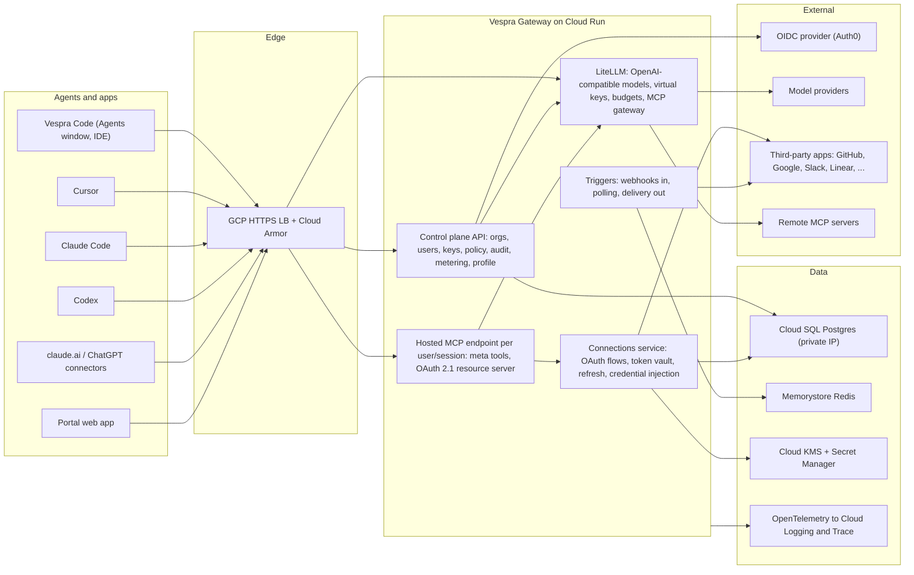
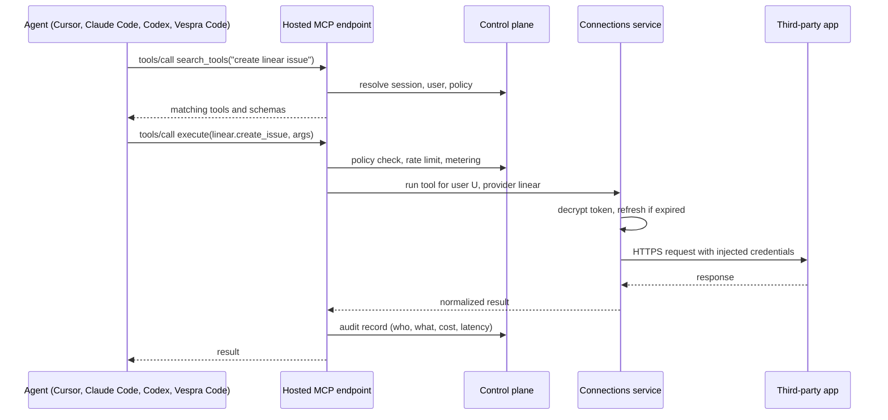

# Vespra Gateway: plan

Status: proposal, waiting for Austin's decisions (section 9). Nothing in this document is built.

## 1. What we are building

One hosted gateway, `gateway.vespra.cloud`, that every AI agent connects to instead of being configured one by one. It has two halves and one control plane:

- Tools gateway (the Composio-like half). Users connect their accounts (GitHub, Google, Slack, Linear, Vercel, GCP, Plane, ...) once. Agents get those apps as tools through a single MCP endpoint or SDK; the gateway injects credentials, enforces policy, logs every call, and fires triggers on external events.
- AI gateway. One OpenAI-compatible endpoint for every model provider, with per-user keys, budgets, routing, fallbacks and logs. LiteLLM already runs this on GCP; it stays and gets put behind the control plane.
- Control plane. Vespra login, organizations, teams and users, API keys, policy, audit, metering and billing, and the agent profile (skills, knowledge, connectors) that any agent can pull.

Who uses it, in this order: Austin, Vespra agents (Agents window, cloud runs), the Vespra team, then outside users who sign up and use it for themselves. That last audience means multi-tenant from the first schema, not retrofitted.

Why this also solves "same skills, knowledge, connectors in every agent": the agent stops being the place where configuration lives. Cursor, Claude Code, Codex, ChatGPT, claude.ai and Vespra Code each get one URL and one key; everything else is served by the gateway.

## 2. What Composio-class scope actually means

Checked against Composio's current docs and pricing (Oct 2026):

| Capability | Composio today | Vespra Gateway target |
|---|---|---|
| Connected accounts | Managed OAuth and API-key auth for 1,500+ toolkits, several accounts per user | Same model; provider catalog grows with demand, starting with the apps we use |
| Sessions | Per-user runtime scope: toolkits, auth, execution state; meta tools (search, connect, execute) so hundreds of tool schemas never enter context | Same; sessions are the unit agents attach to |
| Hosted MCP | Every session has an MCP URL for Claude, Cursor, any client | Same, plus OAuth 2.1 so claude.ai and ChatGPT connectors work |
| Triggers | Webhook and polling triggers, delivered to your endpoint | Same, delivered to webhooks or to Vespra agent runs |
| Custom tools and MCP | Bring your own MCP server or REST tool | Same |
| Sandbox | Hosted code execution for agents | Later; we already have server-side Agent Hosts and VM provisioning plans |
| AI gateway | Not offered | LiteLLM behind the control plane |
| Agent profile | Not offered | Skills, instructions and knowledge served to any agent |
| Pricing shape | Free 100K calls, then per call and per trigger | Metering built in from the start so we can price the same way |

"More in depth" in practice means: the AI gateway and the agent profile under the same identity and keys, policy that spans models and tools (a budget or a rule can cover both), and deep integration with Vespra Code rather than a generic SDK only.

## 3. Build versus compose

Recommendation: own the control plane, the connections service and the agent-facing API; compose proven components underneath; keep every external component replaceable behind our API.

| Layer | Recommendation | Why | Rejected or deferred |
|---|---|---|---|
| Identity (Vespra login) | OIDC provider, Auth0 first, swap later if needed | Already in `features/ideas.md`; OIDC and PKCE from Electron is standard; fastest to production | Keycloak or Zitadel self-hosted: more to operate now, revisit when cost matters |
| AI gateway and MCP gateway core | LiteLLM (MIT), already deployed | Virtual keys, orgs/teams/users, budgets, spend tracking, model routing, guardrails, and an MCP gateway with per-key/team/tool permissions and a fixed `/mcp` endpoint | Kong AI Gateway: strong edge, weaker fit for per-user agent sessions; keep for the edge later |
| Connections (per-user OAuth, token vault, refresh, proxy) | Build in TypeScript | This is the differentiating core and the sensitive part; the surface is narrow (OAuth2 code+PKCE, refresh, API key, basic) and the long tail is provider metadata, not logic | Nango: good design to study, but free self-hosting is auth and proxy only and the Elastic License 2.0 forbids offering it as a hosted service to third parties, which is exactly the external-user case. Arcade: commercial, closed |
| Hosting stdio MCP servers and per-user OAuth to remote MCP servers | Defer; evaluate Obot (MIT) or IBM ContextForge (Apache-2.0) when needed | LiteLLM's MCP gateway covers remote servers with static or key auth; sandboxed hosting is a later need | Building a sandbox runtime now |
| Edge | GCP HTTPS load balancer, Cloud Armor, Cloud Run | Lowest operations cost; nothing in milestone 1 needs Kong | Kong: adopt when we need plugins, per-customer quotas at the edge, or partner routing |
| Portal | Our own web app | Users must never need the LiteLLM admin UI | Exposing LiteLLM UI directly |

LiteLLM note: some LiteLLM features (admin UI SSO, parts of guardrails and audit) are gated behind an enterprise license key. The plan uses only the open parts and keeps our own audit log; verify the exact gating before milestone 1 design freezes.

## 4. Architecture

Request flow for a tool call from any agent:

Agents never see credentials; sessions keep tool schemas out of context until needed (Composio's meta-tool pattern).

## 5. Tenancy and data model

Multi-tenant from the start because outside users are an explicit audience.

- Organization: billing and policy boundary. Personal organizations are created on signup so an individual and a company are the same shape.
- Team: optional grouping inside an organization for policy and budgets.
- User: a person authenticated through the OIDC provider; membership in organizations with roles (owner, admin, member).
- API key: belongs to a user or a service account inside an organization; scoped to models, toolkits, tools, budgets and rate limits. Mapped one-to-one onto a LiteLLM virtual key so model spend and tool spend share one record.
- Connected account: a user's authorization to one provider (several per provider allowed, e.g. work and personal); tokens encrypted with a per-organization KMS data key.
- Session: a scoped runtime context for an agent run (user, toolkits, connected accounts, policy); has an MCP URL.
- Tool and toolkit: catalog entries with JSON schemas; sourced from our provider definitions, from remote MCP servers, or from user-defined custom tools.
- Trigger subscription and delivery: what to watch and where to deliver.
- Audit event: every tool call, model call, connection change and key change.
- Usage record: metered units (tool calls, trigger events, model tokens, cost) per key, user, team, organization.
- Agent profile: skills, instructions and knowledge entries at organization and user scope, with a version so clients can sync.

## 6. Agent-facing surface

This is what makes every agent behave the same.

| Agent | Models | Tools | Profile |
|---|---|---|---|
| Vespra Code (IDE and Agents window) | Built-in provider pointing at `/v1` with the user's key; a Vespra harness later | Gateway MCP endpoint registered by default in the Agents window | Pulled on sign-in and written into the workspace customization locations |
| Cursor | BYOK base URL to `/v1` | `.cursor/mcp.json` or user-level MCP entry pointing at `/mcp` | `vespra agent sync` writes `.agents/skills`, rules, `AGENTS.md` fragments |
| Claude Code | `ANTHROPIC_BASE_URL` to the gateway | `claude mcp add --transport http vespra https://gateway.vespra.cloud/mcp` | Same CLI |
| Codex | Custom model provider in `config.toml` | `[mcp_servers.vespra] url = ...` with bearer token from env | Same CLI |
| claude.ai and ChatGPT | Not applicable | Custom connector to `/mcp`; requires OAuth 2.1 on our side | Bundle export for Projects until connectors can carry it |

Endpoints:

- `/v1/*`: OpenAI-compatible, served by LiteLLM, authenticated by gateway keys.
- `/mcp`: Streamable HTTP MCP. Meta tools `search_tools`, `connect_account`, `execute`, plus pinned tools per session. OAuth 2.1 authorization server metadata so consumer chat apps can connect; bearer API keys for CLIs.
- `/api/*`: control plane REST with an OpenAPI document; the TypeScript SDK is generated from it.
- `/connect/*`: hosted connect flow (white-label later) that returns to the calling agent or portal.
- `/hooks/*`: inbound webhooks for triggers.
- `/profile`: versioned agent profile for `vespra agent sync`.

## 7. Stack and repository

- Language: TypeScript on Node 24, same as `vespracode`, so skills, SDK and Vespra Code integration share types.
- Services: modular monolith first (`api` with modules for control plane, MCP endpoint, connections, triggers), split into services only when a module needs independent scaling. LiteLLM is the one separate service from day one.
- Framework: Fastify (or Hono) with Zod schemas and generated OpenAPI; Drizzle or Prisma on Postgres.
- Data: Cloud SQL Postgres on private IP (the LiteLLM database is moved onto the same instance per Phase 4 of the GCP review), Memorystore Redis for sessions, rate limits and trigger queues, Cloud KMS envelope encryption for tokens, Secret Manager for provider client secrets.
- Runtime: Cloud Run services in `vespra-infrastructure` (or a new `vespra-gateway` project if we want a cleaner blast radius), Terraform in the repo, CI with GitHub Actions.
- Observability: OpenTelemetry to Cloud Trace and Logging; structured audit log in Postgres.
- Repository: new `vespra-company/gateway` with `apps/api`, `apps/portal`, `packages/sdk`, `packages/catalog` (provider and tool definitions), `packages/cli` (`vespra agent sync`), `infra/`. Keeps `vespracode` focused on the editor; the editor consumes the SDK.

## 8. Milestones

No calendar estimates; each milestone is defined by what works end to end.

M0, decisions and foundation
- Decisions in section 9 taken.
- Repository, Terraform skeleton, Cloud Run deploy of a hello service behind the load balancer on `gateway.vespra.cloud`, Auth0 tenant and application.
- LiteLLM hardened: private IP database, SSL required, backups, admin UI not public (Phase 4 of the GCP review).

M1, one URL for every agent
- Vespra login, organizations, users, API keys; a key maps to a LiteLLM virtual key.
- `/v1` works from Cursor (BYOK), Claude Code, Codex and Vespra Code with one gateway key each.
- `/mcp` aggregates the MCP servers we already use (GitHub, Context7, Playwright, Vercel, Cloudflare, Upstash) with per-user allow lists and the three meta tools; connected from Cursor, Claude Code, Codex, claude.ai and ChatGPT.
- Audit log and usage records for every model and tool call; a minimal portal that shows keys, usage and logs.
- Exit test: same task performed in Cursor, Claude Code and Codex using the same tools and the same models with only a gateway key configured.

M2, connected accounts
- Connections service with OAuth2 (code and PKCE), refresh, API-key and basic auth; token vault on KMS.
- First providers: GitHub, Google (Gmail, Calendar, Drive), Slack, Linear, Notion, Vercel, GCP, Plane. Each ships with a small set of high-value tools and a generic authenticated proxy call.
- Hosted connect flow returned to the agent; `connect_account` meta tool works mid-conversation.
- Exit test: an agent in any client creates a Linear issue and posts to Slack using the user's own accounts, with no credentials on the machine.

M3, triggers, catalog, SDK, profile
- Webhook and polling triggers with delivery to webhooks and to Vespra agent runs.
- Tool catalog with search and schemas; custom tools and bring-your-own MCP servers.
- TypeScript SDK and `vespra agent sync` CLI; agent profile served from the gateway and written into Cursor, Claude Code and Codex locations.
- Budgets and rate limits per key, team, organization across models and tools.

M4, for others
- Public signup with personal organizations, email verification, abuse controls, per-organization rate limits.
- White-label connect UI, OAuth app verification where providers require it (Google is the slow one; start early).
- Billing with metered usage, docs site, status page.
- Vespra Code integration: Agents window signs in to the gateway, registers the MCP endpoint and model provider automatically, syncs the profile.

## 9. Decisions needed from Austin

1. Identity provider: Auth0 (recommended for speed) or self-hosted Keycloak/Zitadel.
2. Connections layer: build our own (recommended; license-clean for external users) or start on Nango's free self-hosted auth and proxy knowing we must replace it before serving outside users.
3. Home: new repository `vespra-company/gateway` deployed to `vespra-infrastructure`, or a new GCP project `vespra-gateway` for isolation.
4. First providers: confirm or edit the M2 list.
5. First client: Vespra Code Agents window, or your own Cursor and Claude Code setup first (M1 exit test assumes the latter).
6. Agent profile work in `vespracode`: the local sync script drafted on 25 Oct (stashed on branch `cursor/agent-profile-sync-ab8e`, not committed) can become the `vespra agent sync` client in M3, or be dropped. Decide whether to finish it now as a repo-only tool or wait for the gateway.

## 10. Risks

- Token vault compromise is the worst case; mitigations are KMS envelope encryption, per-organization keys, no plaintext tokens in logs, short-lived access tokens where providers allow, and an audit trail on every decrypt.
- Provider OAuth app reviews (Google, Slack, Microsoft) take time and require a privacy policy, verified domain and scopes justification; start applications in M1.
- Scope creep: Composio has years of catalog work. Breadth comes from demand and from letting agents write provider definitions, not from pre-building everything.
- LiteLLM enterprise gating and upgrade churn; keep our own audit and portal so a swap stays possible.
- Consumer chat connectors (claude.ai, ChatGPT) change their connector rules often; treat them as best-effort clients.
- Running a multi-tenant service for outsiders brings abuse, support and compliance work that a personal gateway does not.

## 11. Related

- [Platform questions, 20 Oct 2026](2026-10-20-platform-questions.md) sections 3.2 (Kong), 4.1 (customizations), 4.4 (own compute), 6 (auth).
- [GCP permissions review](2026-10-20-gcp-permissions.md) and the pending Phase 3 and 4 infrastructure work.
- `features/ideas.md`: Vespra login, plugin marketplace, Vespra harness, own remote compute.
